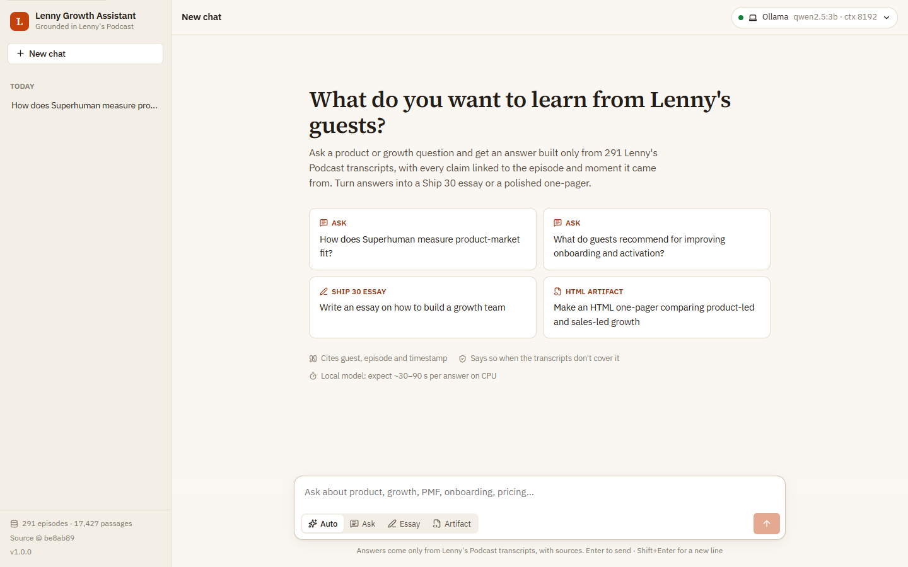
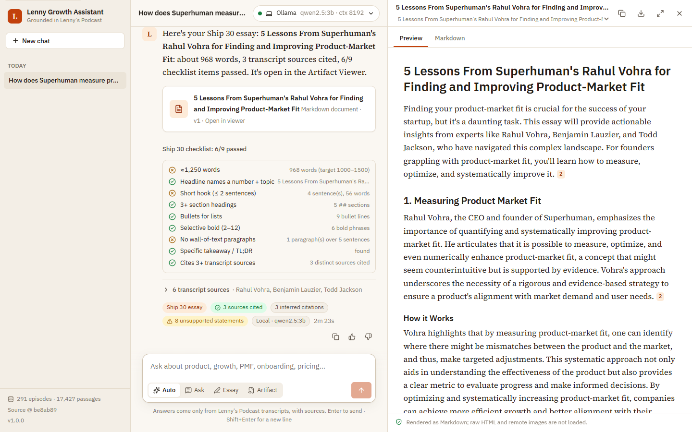
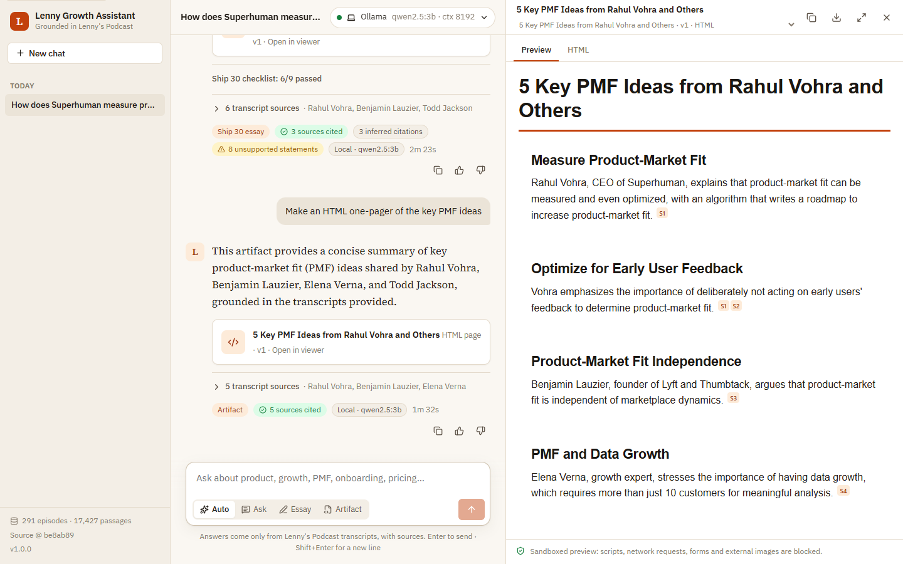
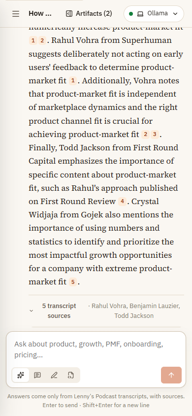
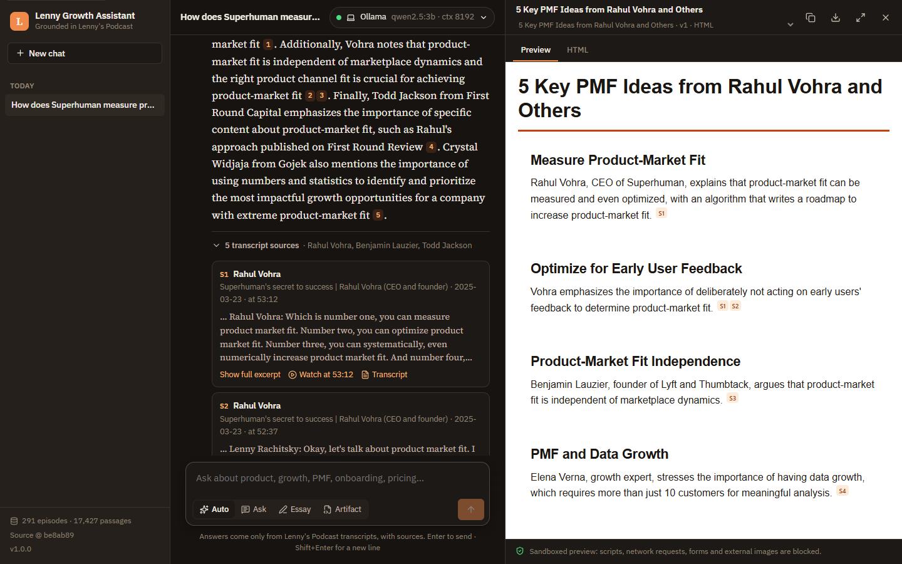

# Design: The Lenny Growth Assistant

This document covers the UI/UX principles, information architecture, interaction states, responsive behaviour, accessibility and the design decisions behind them.

| Empty state | Grounded answer + sources |
|---|---|
|  |  |
| **Ship 30 essay in the Artifact Viewer** | **HTML one-pager (sandboxed)** |
|  |  |
| **Mobile** | **Dark mode** |
|  |  |

---

## 1. Principles

1. **Trust is visible, not claimed.** Every claim carries a citation chip. Every answer shows *how* it was produced: the route (Ask, Essay or Artifact), the model (local or cloud), the time taken and grounding badges ("4 sources cited", "1 inferred citation", "2 unsupported statements"). Users should be able to tell a well-supported answer from a shaky one at a glance.
2. **Evidence one click away.** Citations aren't footnotes at the bottom of a page. A chip opens the exact excerpt, with **Watch at 53:12** (a YouTube deep link) and **Transcript** (a commit-pinned source file).
3. **Honest states over spinners.** Local models are slow on CPU, so the UI narrates the work: *Searching transcripts → 5 passages found (with guest chips) → Writing with qwen2.5:3b… 12s → streamed text.* Essays narrate each section. Waiting feels like progress, and a stalled step is obvious.
4. **No dead ends.** Every failure renders as a message with a reason and a next step: not covered, model down, timeout or network error. Degraded answers still show the evidence.
5. **No AI knobs.** Users never see prompts, temperatures or tokens. The only model choice is a plain "Ollama (local) / Claude (cloud)" switch with a readiness dot, because the brief requires the provider to be visible.
6. **Reading-first typography.** Answers and documents are long-form reading, so they use a serif (Source Serif 4) on warm paper. Chrome uses IBM Plex Sans. One accent colour (burnt orange) marks actions and citations, and nothing else competes with it.

## 2. Information architecture

```
App
├── Sidebar (nav)                   chats grouped by Today / Yesterday / Previous 7 days / Older
│   ├── New chat                    (Ctrl/Cmd + K)
│   ├── Chat list                   select · delete (with confirm)
│   └── Footer                      KB stats (episodes · passages), source commit, version
├── Main
│   ├── Top bar                     chat title · "Artifacts (n)" reopen · Provider switch
│   ├── Banners                     API unreachable · KB indexing · provider unavailable/provisioning
│   ├── Thread
│   │   ├── User message            right-aligned bubble
│   │   └── Assistant message       markdown + citation chips
│   │       ├── Callouts            evidence-only (degraded) · not covered
│   │       ├── Artifact card       opens the viewer
│   │       ├── Ship 30 checklist   (essays) expandable, pass/fail per check
│   │       ├── Sources             expandable cards; cited first, "retrieved, not cited" labelled
│   │       └── Meta row            route · grounding badges · model · time · copy · 👍 👎
│   └── Composer                    textarea · mode switch (Auto/Ask/Essay/Artifact) · Send/Stop
└── Artifact Viewer (aside)         title · version selector · copy · download · full screen · close
    ├── Tabs                        Preview | HTML/Markdown source
    └── Footer                      sandbox statement + "Removed: …" report
```

URL state: `#/c/<session-id>` deep-links a chat, so reload and back/forward work.

## 3. Key interaction states

| State | What the user sees |
|---|---|
| **First run / empty** | Headline, a one-paragraph promise, four starter cards labelled by type (Ask ×2, Ship 30 essay, HTML artifact), and notes: "Cites guest, episode and timestamp", "Says so when the transcripts don't cover it", plus a speed note when the provider is local. Starters fill the composer *and* set the mode; they don't auto-send, so users learn the controls. |
| **KB indexing** (first boot) | Info banner: "Building the knowledge base… (about a minute)". The footer shows "Indexing transcripts…". |
| **Provider provisioning** | Amber pulsing dot and a "Preparing model…" banner with an explanation. |
| **Sending → retrieving** | Optimistic user bubble. The assistant row shows a spinner, the stage label and an elapsed timer. |
| **Sources found** | Green "5 passages found" chip and guest chips before any text arrives, so users know the answer is grounded. |
| **Waiting for first token** | Shimmer skeleton. After 8 s on a local model, a note explains that CPU models take ~20–40 s for the first words. |
| **Streaming** | Markdown renders live with a blinking caret. Citation chips appear as they stream. A **Stop** button replaces Send. |
| **Stopped** | Toast: "Stopped. The server still finishes and saves this answer; reopen the chat to see it." This is true because turns run server-side. |
| **Complete** | Badges, sources and actions. An artifact opens the viewer automatically. |
| **Not covered** | Blue info callout ("No transcript passage answers this, so the assistant declined instead of guessing") plus rephrasing suggestions. |
| **Degraded (evidence-only)** | Amber callout with the error and hint, followed by the top passages with citations. |
| **Error** (network, 5xx) | Red callout with the message, hint, request id, **Try again** and **Dismiss**. |
| **Artifact viewer** | Preview/source tabs; version selector when several exist; copy and download; full screen; Esc to close; a sandbox statement and the list of removed elements. |

## 4. Responsive behaviour

| Width | Layout |
|---|---|
| ≥ 1180 px | Three columns: sidebar (272 px) · chat (max 780 px reading column) · artifact viewer (≈44 vw, 400–780 px). Chat and viewer sit side by side, like Claude Artifacts. |
| 820–1180 px | Two columns. The viewer becomes a right-side overlay panel with a shadow, closable with Esc or ✕. |
| < 820 px | One column. The sidebar becomes a drawer (hamburger, scrim, focus stays in the page). Mode labels collapse to icons. The provider pill hides the model name. Starter cards stack. The viewer is full width. |

The reading column is capped at ~70 characters per line. Composer and buttons have ≥ 32 px hit targets, and `100dvh` keeps the composer visible above mobile browser chrome.

## 5. Accessibility

- **Landmarks and semantics:** `nav` (chats), `main`, `aside` (artifact viewer), `article` per assistant answer, `header` and `h2` for the chat title. A **skip link** goes to the message box.
- **Keyboard:**
  - Composer: Enter sends, Shift+Enter adds a newline. `/` focuses the composer, Ctrl/Cmd+K starts a new chat, and Esc closes menus, the viewer and full screen.
  - Everything is reachable by Tab, with a visible 2 px focus ring.
- **Screen readers:**
  - Live progress uses `role="status"` / `aria-live="polite"`, and errors use `role="alert"`. Pending answers are `aria-busy`.
  - Citation chips are buttons labelled "Source S1: Rahul Vohra: Superhuman's secret to success at 53:12".
  - The mode switch is a `radiogroup`, and the provider menu uses `menuitemradio` with `aria-checked`.
  - Viewer tabs use `tablist`/`tab`/`tabpanel`, and icon buttons have `aria-label`s.
- **Contrast:** text tokens meet WCAG AA on their backgrounds in both themes (ink `#221d17` on paper `#faf7f2`; secondary text `#5a5045`). The accent is never the only signal: badges carry icons and text.
- **Motion:** every animation (spinner, shimmer, caret, slide-in) is disabled under `prefers-reduced-motion`.
- **Colour scheme:** light and dark follow `prefers-color-scheme`, with the same token names re-mapped.

## 6. Visual language

| Token | Light | Dark | Use |
|---|---|---|---|
| `--bg` | `#faf7f2` warm paper | `#161311` | canvas |
| `--surface` | `#ffffff` | `#1d1916` | cards, composer, viewer |
| `--text` | `#221d17` ink | `#f2ece4` | body |
| `--accent` | `#c2410c` burnt orange | `#f08a4b` | primary actions, citations, active mode |
| `--ok` / `--warn` / `--danger` | green / amber / red | lighter variants | grounding badges, callouts |

Type: Source Serif 4 (answers, documents, headline), IBM Plex Sans (UI), IBM Plex Mono (code). The fonts are self-hosted via `@fontsource`, so the app works offline and makes no third-party requests.

Artifacts get a matching default stylesheet inside the sandbox: paper canvas, accent rule under the H1, styled tables and blockquotes. Even a terse 3B-model page therefore looks intentional and on-brand. Model CSS can still override it.

## 7. Design decisions and alternatives

| Decision | Alternatives considered | Why |
|---|---|---|
| Citation **chips that open source cards** inline | Footnotes; hover-only popovers | Inline chips keep reading flow. Cards hold a full excerpt and two links, which a popover can't hold accessibly. Clicking expands and highlights the card. |
| **Auto mode plus explicit modes** | Auto only; separate pages per tool | Auto handles 90% of cases. Explicit modes give control and teach the skills. The chosen route is shown on every answer, so routing is never a mystery. |
| **Starters fill the composer** rather than auto-send | One-click send | Users see and edit the prompt and learn the mode switch. It also avoids an accidental 2-minute essay on a slow model. |
| **Artifact viewer as a side panel** that auto-opens | Inline rendering in the chat; a new tab | The brief asks for "beside the chat", like Claude Artifacts. Inline HTML would also break the chat's typography and widen the attack surface. |
| **Show uncited and inferred evidence honestly** | Hide weaknesses | Trust is the product (PRD M1). Showing "2 unsupported statements" teaches users when to double-check, and the underlying signal drives the metrics. |
| **Provider switch in the header**, remembered per browser | Settings page; per-message picker | The brief requires visibility. The header is always visible and one click away, and per-message picking would be noise. |
| **Warm editorial palette** | Default chat-app blue/purple gradients | Distinct and calm. It suits long reading and keeps the single accent meaningful. |
| **Stop doesn't cancel server work** | Cancel generation server-side | The answer gets persisted anyway, so nothing is lost. A cancel endpoint is a small follow-up if the team prefers to save compute. |
